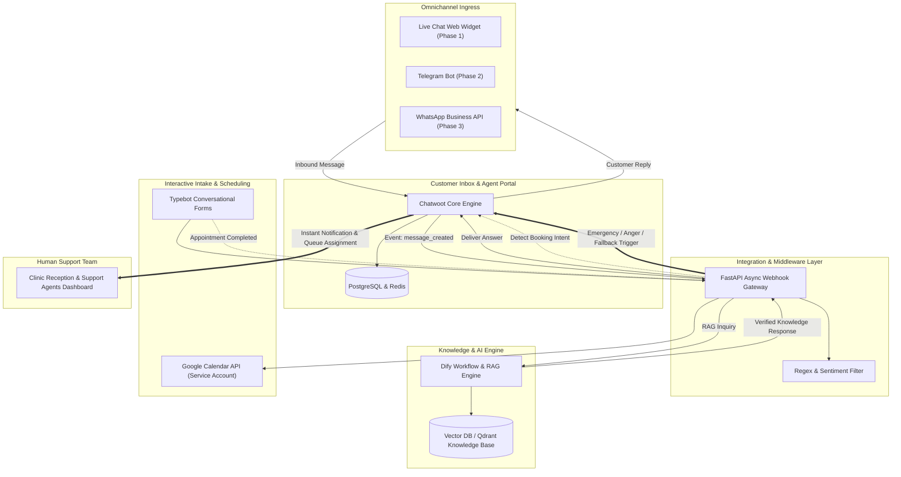
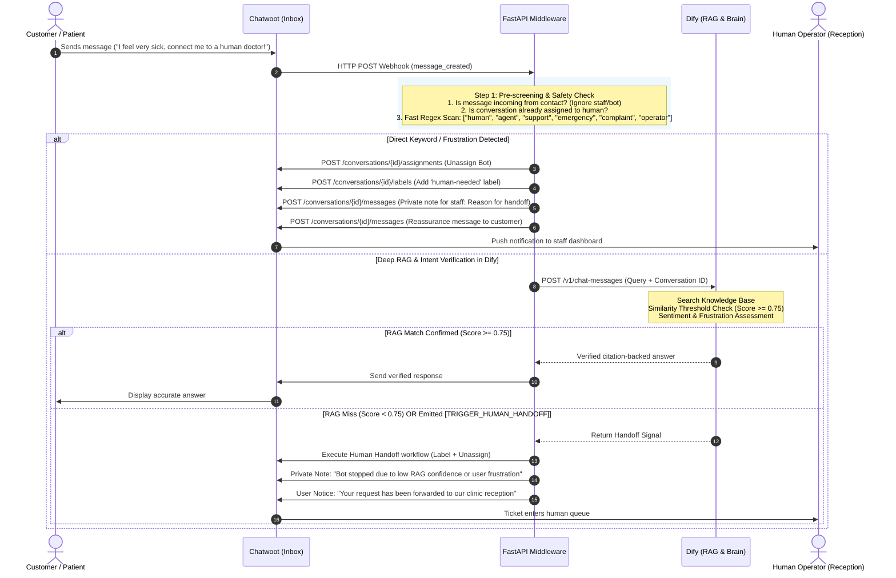
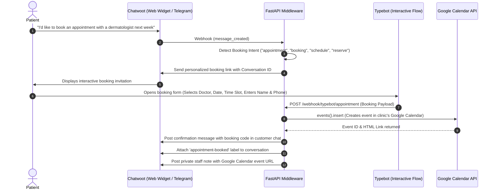

# Omnichannel AI Customer Support & Appointment System with Human Handoff

[](https://fastapi.tiangolo.com)
[](https://www.docker.com/)
[](https://www.chatwoot.com)
[](https://dify.ai)
[](https://developers.google.com/calendar)
[](https://opensource.org/licenses/MIT)

An enterprise-grade, production-ready omnichannel customer support, triage, and automated appointment system with **Zero-Hallucination guarantees** and a **Zero-Fail Human Handoff** mechanism. Designed for clinics, healthcare providers, service centers, and modern e-commerce.

> 🌐 **Language Editions:**
> - **International English Edition:** Default on `main` branch.
> - **Persian Edition (نسخه فارسی):** Preserved on branch [`persian-version`](https://github.com/ME0W004/Omnichannel-AI-Customer-Support-Appointment-System-/tree/persian-version) and release tag [`v1.0.0-fa`](https://github.com/ME0W004/Omnichannel-AI-Customer-Support-Appointment-System-/releases/tag/v1.0.0-fa).

---

## 🌟 Key Problems Solved

1. **Zero Hallucination Guarantee:** AI customer support bots must never guess, prescribe, or provide fabricated tariffs. Every response is strictly grounded in official business documentation (retrieval confidence $\ge 0.75$) with citations.
2. **Zero-Fail Human Handoff:** Whenever a client exhibits frustration/anger, explicitly requests an operator, or asks out-of-scope questions, the bot instantly unassigns itself, marks the ticket with priority labels, and hands over the conversation to human staff with internal context notes.
3. **Automated Calendar Booking:** Eliminates phone receptionist bottlenecks by seamlessly routing appointment inquiries to conversational interactive flows (Typebot) and locking slots directly into **Google Calendar** via Service Account.
4. **Unified Omnichannel Inbox:** One single dashboard for human agents across Website Live Chat, Telegram, and WhatsApp using **Chatwoot**.

---

## 🏛️ High-Level System Architecture



---

## 🔄 Sequence Diagrams

### 1. Message Lifecycle & Zero-Fail Human Handoff Flow



---

### 2. Google Calendar Automated Appointment Flow



---

## 📁 Repository Structure

```
├── caddy/
│   └── Caddyfile                  # Reverse proxy with automated Let's Encrypt SSL
├── docs/
│   └── DEPLOYMENT_GUIDE.md        # Complete multi-stack deployment & configuration guide
├── middleware/                    # Core FastAPI Orchestrator & Handoff Bridge
│   ├── app/
│   │   ├── core/
│   │   │   └── config.py          # Pydantic Settings & environment schemas
│   │   ├── schemas/
│   │   │   └── chatwoot.py        # Webhook payload data validation models
│   │   ├── services/
│   │   │   ├── calendar_service.py # Google Calendar API v3 Service Account integration
│   │   │   ├── chatwoot_client.py # Chatwoot REST API wrapper (handoff, labels, notes)
│   │   │   ├── dify_client.py     # Dify AI client with fallback & citation parsing
│   │   │   └── handoff_detector.py # Regex fast filters for handoff & booking intents
│   │   └── main.py                # Async webhook receiver & background task dispatcher
│   ├── Dockerfile                 # Lean Python 3.11 container image
│   ├── requirements.txt           # Python dependencies
│   ├── test_webhook.py            # Automated end-to-end test suite (6 real scenarios)
│   └── .env.example               # Environment variables template
├── web/
│   └── widget-demo.html           # Live demo landing page with responsive Chatwoot widget
├── docker-compose.yml             # Container orchestration (Middleware + Caddy)
└── README.md
```

---

## 🛡️ Anti-Hallucination & RAG Configuration

To eliminate hallucinations in medical and customer service environments, configure Dify with the following parameters:

- **Segment Mode:** Custom
- **Segment Length:** 500 Tokens
- **Overlap:** 50 Tokens (10%)
- **Search Method:** Hybrid Search (Vector Embedding + Full-text Keyword)
- **Reranker Model:** BGE Reranker or Cohere Rerank v3
- **Top-K:** 3
- **Similarity Score Threshold:** `0.75` (Blocks any retrieved chunk below 75% relevance)

### Dify Anti-Hallucination System Prompt:
```text
You are the official verified medical/service AI assistant.

CRITICAL GUARDRAILS (STRICT ZERO-HALLUCINATION RULES):
1. You must answer strictly and solely based on the retrieved context provided in the knowledge base.
2. Never guess, infer, or prescribe treatments or tariffs that are not explicitly documented.
3. If the user's question cannot be answered with 100% certainty from the provided context, output ONLY the token:
   [TRIGGER_HUMAN_HANDOFF]
4. If the user exhibits extreme frustration, anger, mentions medical emergencies, or demands a human operator, output ONLY the token:
   [TRIGGER_HUMAN_HANDOFF]
```

---

## ⚡ Quick Start & Deployment

### 1. Prerequisites
- Linux Server (Ubuntu 22.04 / 24.04 LTS recommended)
- 4-8 vCPUs, 16-32 GB RAM, 80GB NVMe SSD
- Docker and Docker Compose installed

### 2. Create Shared Isolated Network
```bash
docker network create omnichannel-net
```

### 3. Deploy Chatwoot & Dify
Follow the detailed step-by-step instructions in [DEPLOYMENT_GUIDE.md](docs/DEPLOYMENT_GUIDE.md) to launch the official Chatwoot and Dify containers attached to `omnichannel-net`.

### 4. Configure & Start Middleware
```bash
cd middleware
cp .env.example .env
# Fill in your Chatwoot Token, Dify API Key, and Google Calendar ID

cd ..
docker compose up -d --build
```

### 5. Verify Service Health
```bash
curl http://localhost:8000/health
# Response: {"status":"healthy","service":"Omnichannel AI Bridge",...}
```

---

## 🧪 Testing & Verification

The repository includes an automated test script ([`test_webhook.py`](middleware/test_webhook.py)) that simulates 6 mission-critical customer workflows:

```bash
cd middleware
python test_webhook.py
```

### Verified Scenarios:
| # | Scenario | Input | Expected System Behavior | Result |
|---|---|---|---|---|
| **1** | Normal Inquiry | "What are the clinic's operating hours and consultation days?" | Forwarded to Dify RAG; grounded response returned | ✅ Passed (HTTP 200) |
| **2** | Direct Operator Request | "Please connect me to a human support agent or operator right away." | Fast Regex triggers immediate handoff before LLM call | ✅ Passed (HTTP 200) |
| **3** | Angry Sentiment | "This service is unacceptable! I want to file a complaint!" | Emergency handoff triggered; tagged priority | ✅ Passed (HTTP 200) |
| **4** | Bot Silence on Handoff | Subsequent messages after handoff | Bot remains completely silent; human agent retains chat | ✅ Passed (HTTP 200) |
| **5** | Appointment Intent | "Hi, I would like to schedule an appointment with a specialist next week." | Intent detected; personalized Typebot link returned | ✅ Passed (HTTP 200) |
| **6** | Typebot to Calendar | Form completion payload | Event booked in Google Calendar; confirmation sent | ✅ Passed (HTTP 200) |

---

## 🗺️ Channel Rollout Roadmap

- [x] **Phase 1: Web Live Chat Widget:** Embedded responsive widget ([Demo](web/widget-demo.html)).
- [x] **Phase 1: Google Calendar Automation:** Automated booking through Service Account API v3.
- [ ] **Phase 2: Telegram Bot Integration:** Connect BotFather token to Chatwoot Inboxes (zero backend code change required).
- [ ] **Phase 3: WhatsApp Business API:** Route WhatsApp Cloud API webhooks into Chatwoot for enterprise messaging.

---

## 📄 License

This project is licensed under the MIT License - see the [LICENSE](LICENSE) file for details.
